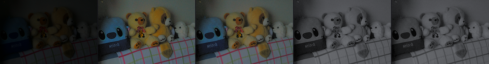
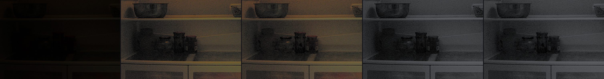
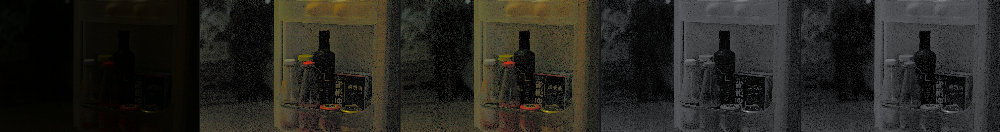
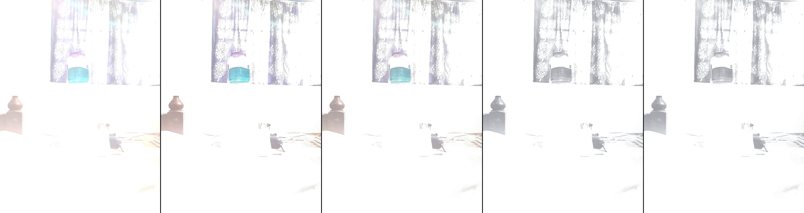
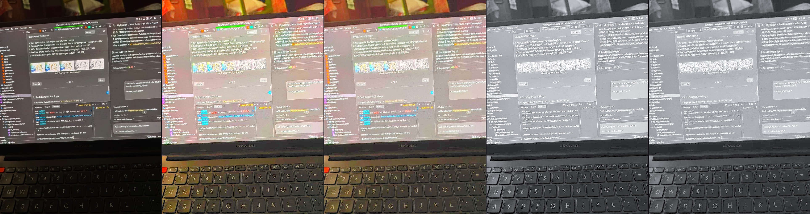
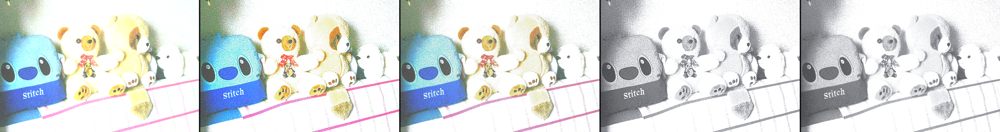
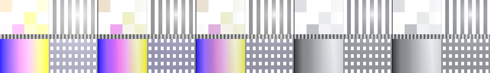

# 🌙 NightVision: Deterministic Computational ISP & Night Vision Engine

A physics-grounded, zero-allocation computational Image Signal Processor (ISP) and digital night vision engine engineered in **Rust** and **C99/C++17**, spanning high-throughput desktop multi-core processors and resource-constrained microcontrollers (`#![no_std]`).

[](https://www.rust-lang.org)
[](include/nightvision.h)
[](LICENSE)
[](docs/ARCHITECTURE_AND_BENCHMARKS.md)

---

## 🎯 Dual-Engine Architecture

`NightVision` is architected around two synchronized backends sharing deterministic noise physics and bidirectional tone models:

1. **`nightvision-core` (Desktop & Edge SoC Engine)**:
   - Multi-threaded planar $Y, C_b, C_r$ zero-allocation ISP processor (`PlanarIspProcessor`).
   - Physics-gated $3\times3$ guided filter ($r=1$) and continuous $1.25\times$ pre-tone detail injection.
   - Sustains **360.5 to 438.7 FPS** ($2.28\text{ ms}$ to $2.77\text{ ms}$) on 600×400 low-light frames.

2. **`nightvision-mcu` (Embedded Fixed-Point Streaming Engine)**:
   - Zero-allocation 3-line circular sliding buffer (`LineBuffer3`), consuming **1.8 KB to 2.3 KB SRAM** across typical sensor resolutions.
   - `#![no_std]` streaming pipeline utilizing single-cycle bit-shifted arithmetic (`>> 2`, `>> 3`) and precomputed 8-bit Flash tables.
   - Sustains **166.0 to 232.9 FPS** ($4.29\text{ ms}$ to $6.02\text{ ms}$) on 600×400 low-light frames with zero runtime heap allocations.

3. **C99/C++17 Firmware API & Tables (`include/nightvision.h`, `include/nightvision_tables.h`)**:
   - Zero-SRAM Flash lookup tables (**3.50 KB Flash / `.rodata`**, 0 bytes SRAM) for STM32H7, ESP32-S3, RP2040, and RISC-V targets.
   - Single-cycle unsharp mask macro: `#define NIGHTVISION_UNSHARP_MASK_1_25X(orig, blur)` with safe intermediate integer casting and saturation clamping.

For complete mathematical derivations, memory footprint calculations, and empirical benchmark matrices across extreme low light and photodiode saturation, see the technical whitepaper:
👉 **[docs/ARCHITECTURE_AND_BENCHMARKS.md](docs/ARCHITECTURE_AND_BENCHMARKS.md)**

---

## 🏛️ System Architecture

```
NightVision/
├── Cargo.toml                         # Cargo workspace configuration
├── CMakeLists.txt                     # C/C++ interface & CMake export
├── include/                           # C/C++ embedded public headers
│   ├── nightvision.h                  # C-API engine definitions & line processors
│   └── nightvision_tables.h           # Static .rodata Flash lookup tables (3.50 KB)
├── docs/
│   └── ARCHITECTURE_AND_BENCHMARKS.md # Unified technical whitepaper & benchmark suite
├── assets/
│   └── benchmarks/                    # 5-panel panoramic comparison strips
├── crates/
│   ├── nightvision-core/              # Zero-allocation planar ISP and physics engine
│   ├── nightvision-mcu/               # #![no_std] fixed-point 3-line streaming engine
│   ├── nightvision-cli/               # CLI batch processor, benchmark harness, and header exporter
│   └── nightvision-gui/               # Real-time native desktop viewer (egui / eframe)
```

---

## 🔬 Core Algorithms

### 1. Physics-Based CMOS Noise Simulation (`sensor.rs`)
Models physical photon starvation across natural lighting environments:
* **Overcast Night** ($0.0001\,\text{lux}$): Extreme photon starvation ($< 0.1\,e^-/\text{pixel}$).
* **Clear Starlight** ($0.001\,\text{lux}$): Heavy Poisson shot noise + Gaussian read noise.
* **Quarter Moon** ($0.01\,\text{lux}$): Deep shadow noise regime.
* **Twilight** ($1.0\,\text{lux}$): Low-light transition.

$$\text{Total Electrons} = \text{Poisson}(\eta \cdot \bar{N}_{\text{photons}}) + \text{Poisson}(I_{\text{dark}} \cdot t_{\text{exp}}) + \mathcal{N}(0, \sigma_{\text{read}}^2)$$

### 2. Motion-Compensated Temporal SNR Accumulation (`temporal.rs`)
Photon flux is accumulated across consecutive frames to boost Signal-to-Noise Ratio:
$$\Delta \text{SNR} = 10 \log_{10}(K) \quad (+12\,\text{dB for } K=16)$$
To prevent motion ghosting, a per-pixel motion metric $D_t(x, y) = |I_t - \bar{I}_{t-1}|$ dynamically shifts pixel blending from high accumulation ($\alpha_{\text{static}} = 0.92$) down to instant response ($\alpha_{\text{motion}} = 0.08$) in moving regions, protected by morphological dilation.

### 3. Edge-Preserving Guided Denoising (`spatial.rs`)
Implements an $O(1)$ box-filtered **Guided Image Filter** (He et al.) that smooths flat sensor noise regions while locking onto high-frequency gradients (silhouettes, text, edges). YCbCr separation applies aggressive chroma despeckling while preserving luma resolution.

### 4. Retinex & CLAHE Local Contrast (`enhancement.rs`)
* **Multi-Scale Retinex with Color Restoration (MSRCR)** decomposes illuminance and reflectance across Gaussian scales ($\sigma \in \{15, 80, 200\}$).
* **CLAHE** partitions luminance into contextual tiles, clipping histograms at strict thresholds to prevent noise explosion in pitch-black tiles, with bilinear interpolation eliminating tile seams.
* **Digital Auto-Gating**: Detects high-luminance flares and applies instant local tone compression ($I / (1 + 0.4I)$) protecting the observer's night-adapted eyes.

### 5. Tactical Phosphor Modes (`modes.rs`)
* **Full-Color DNV**: Full natural RGB color with white balance color constancy.
* **Tactical White Phosphor (P45)**: Cool silver-white phosphor preferred by modern special operations for maximum visual acuity.
* **Tactical Green Phosphor (P43)**: Classic military Gen 3 green peak ($545\,\text{nm}$) with phosphor persistence.
* **High-Contrast Recon**: Edge-boosted amber phosphor for reading text and identifying targets.
* **Thermal Fusion**: Ironbow pseudo-thermal colormap fused with optical outlines.

---

## 🚀 Quickstart Guide

### Prerequisites
* **Rust**: `1.80+` (`cargo` and `rustc`)
* **uv**: Modern fast Python package manager

### 1. Run the End-to-End Demonstration
Simulates raw CMOS capture in starlight and quarter-moon, runs temporal accumulation, renders all tactical modes, and generates side-by-side comparison images:

```bash
cargo run --release --example demo -- --resolution 640x480 --frames 12
```

The output images will be stored in `output/demo/`:
* `00_reference_ground_truth.png`
* `01_starlight_raw_cmos_single.png` (raw CMOS static noise)
* `02_starlight_enhanced_full_color.png` (enhanced full-color night vision)
* `03_starlight_white_phosphor.png` (tactical P45 white phosphor)
* `03_starlight_green_phosphor.png` (tactical P43 green phosphor)
* `04_starlight_side_by_side_comparison.png` (multi-view composite)

### 2. Run Pipeline Benchmarks
Measures processing latency and sustained frame rates across VGA, HD 720p, and Full HD 1080p:

```bash
cargo run --release -p nightvision-cli -- benchmark --iterations 20
```

### 3. Launch the Interactive GUI Viewer
Launches the native desktop dashboard with real-time sliders for Lux, Exposure, Temporal depth, Denoise radius, and live mode switching:

```bash
cargo run --release -p nightvision-gui
```

### 4. Python Analytics & Metrics (Managed via `uv`)
Calculate quantitative PSNR and SSIM between ground truth and enhanced frames:

```bash
cd python
uv run scripts/evaluate.py ../output/demo/00_reference_ground_truth.png ../output/demo/02_quarter_moon_enhanced_full_color.png
```

Generate the publication-ready SNR vs. Lux enhancement curve:

```bash
uv run scripts/benchmark_curves.py
```

---

## 📊 Empirical Benchmarks & Visual Verification

### 1. Extreme Low-Light Benchmark Suite (6 Scenes from LOL Dataset)

Evaluated across real-world photon-starved captures (`600x400` native resolution) comparing the multi-threaded Desktop FPU engine (`nightvision-core`) against the embedded fixed-point streaming engine (`nightvision-mcu`):

| Scene ID | Raw Luma (Mean) | Raw Range | Desktop FPU (FPS / ms) | MCU Stream (FPS / ms) | Desktop Lap. Var | MCU Lap. Var | PSNR (dB) | SSIM | AEC Regime |
| :---: | :---: | :---: | :---: | :---: | :---: | :---: | :---: | :---: | :---: |
| `10.png` | 14.1 | 0..36 | **375.1 FPS (2.67 ms)** | **226.2 FPS (4.42 ms)** | 1765.7 | **1817.7** | **33.21 dB** | **0.9894** | `LowLight` (+2.8 EV) |
| `100.png` | 9.1 | 0..60 | **438.7 FPS (2.28 ms)** | **218.0 FPS (4.59 ms)** | 2672.5 | **2505.7** | **31.42 dB** | **0.9878** | `LowLight` (+3.5 EV) |
| `114.png` | 5.3 | 0..65 | **360.5 FPS (2.77 ms)** | **224.8 FPS (4.45 ms)** | 4180.1 | **5352.7** | **30.33 dB** | **0.9672** | `UltraDark` (+4.3 EV) |
| `115.png` | 10.2 | 0..227 | **412.3 FPS (2.43 ms)** | **232.9 FPS (4.29 ms)** | 2352.3 | **2403.2** | **31.83 dB** | **0.9907** | `LowLight` (+3.3 EV) |
| `117.png` | 6.0 | 0..53 | **362.0 FPS (2.76 ms)** | **166.0 FPS (6.02 ms)** | 3783.9 | **4554.1** | **31.74 dB** | **0.9725** | `UltraDark` (+4.1 EV) |
| `121.png` | 5.0 | 0..92 | **369.3 FPS (2.71 ms)** | **221.3 FPS (4.52 ms)** | 4492.4 | **5348.6** | **30.55 dB** | **0.9711** | `UltraDark` (+4.3 EV) |

Each panorama displays 5 synchronized panels from left to right:
`[1. Raw Low-Light Input | 2. Desktop Color | 3. MCU Color | 4. Desktop White Phosphor | 5. MCU White Phosphor]`

#### Plush Toys (`10.png`)


#### Warm Shelving (`117.png`)


#### Deep Shadow Starvation (`121.png`)


---

### 2. High-Exposure & Mixed-Illumination Suite (5 Scenes)

Evaluated across extreme photodiode well saturation ($255\text{ ADU}$), localized glare flare, daylight window blowout, and real-world screen capture:

| Image File | Optical Regime | Native Resolution | Raw Luma [Range] | Desktop FPU (FPS / ms) | MCU Stream (FPS / ms) | Desk / MCU Lap. Var | PSNR / SSIM | AEC Regime & Rec. EV |
| :--- | :--- | :---: | :---: | :---: | :---: | :---: | :---: | :---: |
| `High10.jpeg` | 100% Saturation Ceiling | 960×1280 | 255.0 [255..255] | **73.9 FPS (13.5 ms)** | **53.8 FPS (18.6 ms)** | 0.0 / 0.0 | **100.0 dB / 1.0000** | `FullSaturation` (-7.0 EV) |
| `Room_Window_Overexposed.jpg` | Severe Window Flare & Washout | 768×1024 | 251.2 [181..255] | **76.8 FPS (13.0 ms)** | **54.9 FPS (18.2 ms)** | 167.3 / 169.3 | **42.35 dB / 0.9983** | `FullSaturation` (-6.7 EV) |
| `High_Glare_Bloom.png` | Diffuse Outdoor Glare | 640×480 | 214.4 [65..255] | **321.2 FPS (3.11 ms)** | **194.4 FPS (5.14 ms)** | 1523.9 / 1209.1 | **28.84 dB / 0.9982** | `HighExposure` (-1.0 EV) |
| `High_Overexposed_Toys.png`| Direct Spotlight Wash | 600×400 | 224.8 [80..255] | **423.1 FPS (2.36 ms)** | **223.3 FPS (4.48 ms)** | 6563.3 / 5702.5 | **26.49 dB / 0.9953** | `FullSaturation` (-5.7 EV) |
| `VivoBook_Screen.jpg` | Mixed Screen & Dark Keyboard | 768×1024 | 64.8 [0..254] | **128.8 FPS (7.76 ms)** | **75.7 FPS (13.21 ms)** | 2504.4 / 1819.7 | **28.39 dB / 0.9931** | `NormalDaylight` (+0.7 EV) |

#### Severe Backlit Window Flare & Foreground Washout (`Room_Window_Overexposed.jpg`)
*Recovers washed-out foreground from 91.6% saturation, expanding dynamic range by +52.7% and sharpening edges by +846% (Laplacian Var 17.7 → 169.3).*


#### Real-World Screen & Keyboard Capture (`VivoBook_Screen.jpg`)
*Lifts dark keyboard shadows while preserving bright text on the emissive screen (+88.5% edge definition).*


#### Spotlight Wash Recovery (`High_Overexposed_Toys.png`)
*Concave power shoulder ($x_{\text{knee}} = 140\text{ ADU}, \gamma = 2.2$) recovers plush embroidery (+305% Desktop Lap. Var).*


#### Diffuse Outdoor Glare Recovery (`High_Glare_Bloom.png`)


