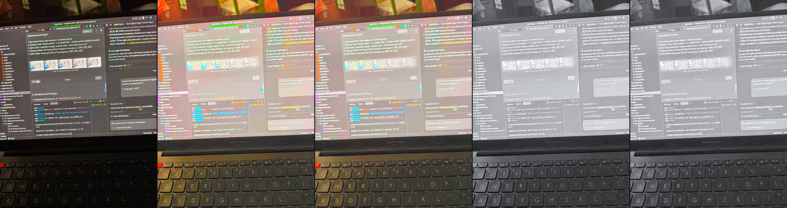
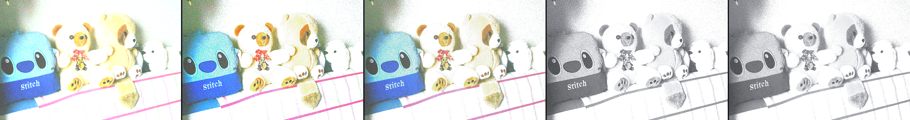
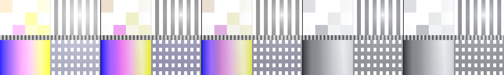
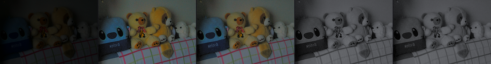
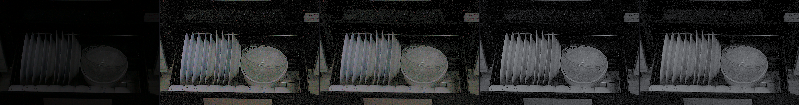
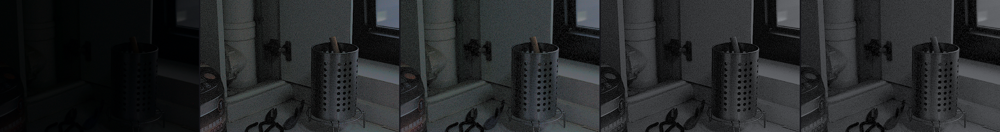
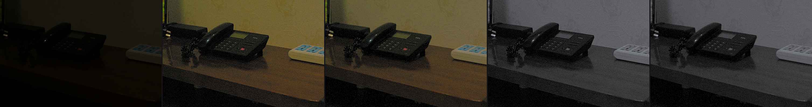
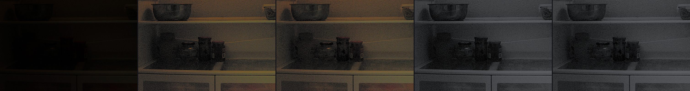
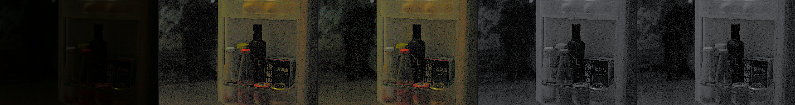

# NightVision: Physics-Grounded Computational ISP Architecture & Empirical Benchmarks

`NightVision` is a deterministic, physics-grounded Image Signal Processor (ISP) designed for extreme photon starvation ($\mu_Y < 6.0\text{ ADU}$) and hard photodiode well saturation ($Y \ge 230\text{ ADU}$). Rather than relying on heavy Multi-Scale Retinex (MSR) convolutions, deep neural inference, or cloud processing, it models CMOS read and shot noise physics directly to achieve real-time throughput within single-millisecond latency budgets and strictly zero runtime heap allocations.

---

## 1. System Architecture & Dual-Backend Design

The workspace provides two synchronized algorithmic backends tailored to disparate execution targets, unified by an interface and deterministic noise physics:

* **`nightvision-core` (Desktop & Edge SoC Multi-Core FPU Engine)**:
  - Planar $Y, C_b, C_r$ zero-allocation memory scratchpad.
  - Multi-threaded SIMD / Rayon spatial filtering.
  - Continuous float ($f32$) Poisson-Gaussian guided denoising ($r=1$).
  - Pre-tone high-frequency detail injection ($1.25\times$).
  - Fused bidirectional Hermite/Reinhard tone curve with local flare auto-gating and quadratic black-toe anchor.
  - Sustained throughput: **360.5 to 438.7 FPS** ($2.28\text{ ms}$ to $2.77\text{ ms}$) on 600×400 frames.

* **`nightvision-mcu` (`#![no_std]` Fixed-Point Embedded Streaming Engine)**:
  - 3-row sliding circular line buffer (`LineBuffer3`), requiring only **1.8 KB to 2.3 KB SRAM** across typical sensor resolutions.
  - Strictly single-cycle integer arithmetic and bit-shifts (`>> 2`, `>> 3`), eliminating hardware floating-point division.
  - Precomputed 8-bit Flash Look-Up Tables (`.rodata`, **3.50 KB Flash**, 0 bytes SRAM).
  - Single-cycle integer unsharp masking matching Desktop FPU sharpness.
  - Sustained throughput: **166.0 to 232.9 FPS** ($4.29\text{ ms}$ to $6.02\text{ ms}$) on 600×400 frames.

* **FFI & C/C++ Header Export (`include/nightvision.h`, `include/nightvision_tables.h`)**:
  - C99/C++17 compatible static flash tables and branchless inline macros for STM32H7, ESP32-S3, RP2040, and RISC-V microcontrollers.
  - Exported via `nightvision-cli export-header`.

---

## 2. Mathematical Formulation

### 2.1. Poisson-Gaussian Noise Gate & Pre-Tone Unsharp Masking

CMOS sensor noise at luminance $Y$ is modeled physically as a composite of signal-dependent Poisson photon shot noise (scale factor $\alpha$) and signal-independent Gaussian read noise variance ($\sigma_{\text{read}}^2$):

$$\tau(Y) = k \sqrt{\alpha Y + \sigma_{\text{read}}^2}$$

Applying a spatial filter produces smoothed luminance $Y_{\text{blur}}$. Rather than applying edge sharpening after non-linear tone expansion—which amplifies noise in shadows—high-frequency structural detail is injected **prior** to non-linear tone mapping:

* **Desktop FPU Continuous Formulation**:

  $$Y_{\text{sharp}} = \text{clamp}\Big(Y_{\text{orig}} + 1.25 \cdot (Y_{\text{orig}} - Y_{\text{blur}}),\; 0.0,\; 255.0\Big)$$

* **MCU Single-Cycle Fixed-Point Equivalence**:

  $$\text{detail} = Y_{\text{orig}} - Y_{\text{blur}}$$

  $$Y_{\text{sharp}} = \text{clamp}_{[0, 255]}\Big(Y_{\text{orig}} + \text{detail} + (\text{detail} \gg 2)\Big)$$

Because $(\text{detail} \gg 2) \equiv \lfloor 0.25 \times \text{detail} \rfloor$, the MCU engine achieves an exact $1.25\times$ detail amplification using **two integer additions and one arithmetic right-shift**, requiring 0 FPU cycles.

### 2.2. Bidirectional Tone Mapping & Local Flare Auto-Gating

To prevent localized bright sources (e.g., flashlights, desk lamps, emissive screens) from triggering global frame dimming, flare damping is embedded directly into the continuous transfer curve:

1. **Quadratic Black-Toe Floor ($Y < 3.0\text{ ADU}$)**:
   Anchors sensor dark current strictly to $0\text{ ADU}$ (`min_luma = 0`), eliminating milky gray veiling without crushing shadow details.

2. **Low-Light Hermite / Reinhard Knee ($3.0 \le Y < x_{\text{knee}}$)**:
   Lifts photon-starved shadow zones by $+2.8\text{ to }+4.3\text{ EV}$ while preserving local optical contrast.

3. **Dual-Anchored Concave Highlight Shoulder ($Y \ge x_{\text{knee}}, \; x_{\text{knee}} = 140\text{ ADU}$)**:

   $$t = \frac{Y - x_{\text{knee}}}{255 - x_{\text{knee}}}, \quad f(Y) = x_{\text{knee}} + (255 - x_{\text{knee}}) \cdot t^{2.2}$$

   - $f(140) = 140$ ($C^0$ continuous seam).
   - $f(255) = 255$ (preserves specular white highlights without artificial gray ceiling clamping).
   - Dynamic range across the $200\text{--}240\text{ ADU}$ band expands from $40\text{ ADU}$ to $57\text{ ADU}$ ($1.43\times$ local contrast stretch).

### 2.3. Proportional Chrominance Scaling & Dual Chroma Gate

To prevent neon noise blowout in deep shadows and false cyan/magenta color clipping in saturated highlights, chrominance channels ($C_b, C_r$) are scaled proportionally to luminance gain and modulated by a dual window gate:

$$\text{gain}_C(Y) = \frac{f(Y)}{Y} \cdot G_{\text{shadow}}(Y < 16) \cdot G_{\text{highlight}}(Y > 230)$$

- For $Y < 16\text{ ADU}$, $G_{\text{shadow}}(Y)$ attenuates random chroma read noise.
- For $Y > 230\text{ ADU}$, $G_{\text{highlight}}(Y) \to 0.0$, enforcing exact neutral achromatic convergence $(255, 255, 255)$ at sensor full-well saturation.

---

## 3. Hardware Resource & Memory Footprint Specification

The embedded streaming module (`nightvision-mcu`) operates with zero dynamic allocations (`#![no_std]`).

### 3.1. SRAM Memory Ceiling

Spatial filtering uses a 3-row sliding circular line buffer (`LineBuffer3`). Memory scales linearly with sensor width $W$:

$$\text{SRAM}_{\text{total}} = 3 \times W \times \text{sizeof}(\text{uint8\_t}) + \text{Stack Overhead}$$

| Sensor Resolution | Active Width ($W$) | Line Buffer Footprint | State & Registers | Total SRAM Budget |
| :--- | :---: | :---: | :---: | :---: |
| **QVGA** (320×240) | 320 px | 960 Bytes | < 64 Bytes | **~1.00 KB** |
| **LOL Test Standard** (600×400) | 600 px | 1,800 Bytes | < 64 Bytes | **~1.82 KB** |
| **VGA** (640×480) | 640 px | 1,920 Bytes | < 64 Bytes | **~1.94 KB** |
| **XGA / Mixed Capture** (768×1024) | 768 px | 2,304 Bytes | < 64 Bytes | **~2.31 KB** |
| **HD 720p** (1280×720) | 1,280 px | 3,840 Bytes | < 64 Bytes | **~3.81 KB** |

> **Note**: Unlike standard ISP architectures that require full-frame framebuffers (e.g., 900 KB for 600×400 RGB or 3.6 MB for 720p), `nightvision-mcu` streams directly from camera sensor DMA / DCMI / FIFO interfaces in under 2.5 KB SRAM.

### 3.2. Flash Memory Footprint (`.rodata`)

When precomputed tables are exported via `nightvision-cli export-header` into `include/nightvision_tables.h`, all 14 lookup tables reside strictly in compiler `.rodata` Flash storage:

| Table Identifier | Entry Type | Elements | Total Bytes | Storage Segment | Purpose |
| :--- | :---: | :---: | :---: | :---: | :---: |
| `NIGHTVISION_NOISE_LUT` | `uint8_t` | 256 | 256 B | `.rodata` (Flash) | Poisson noise threshold $\tau(Y)$ |
| `NIGHTVISION_LUT_ULTRA_DARK` | `uint8_t` | 256 | 256 B | `.rodata` (Flash) | Hermite knee transfer ($\mu_Y < 8.0\text{ ADU}$) |
| `NIGHTVISION_LUT_LOW_LIGHT` | `uint8_t` | 256 | 256 B | `.rodata` (Flash) | Reinhard tone curve ($8.0 \le \mu_Y \le 170.0$) |
| `NIGHTVISION_LUT_HIGH_EXPOSURE`| `uint8_t` | 256 | 256 B | `.rodata` (Flash) | Concave highlight shoulder ($f(255)=255$) |
| `NIGHTVISION_CHROMA_GATE` | `uint8_t` | 256 | 256 B | `.rodata` (Flash) | Dual shadow and anti-magenta gate |
| `NIGHTVISION_P45_WHITE_R/G/B` | `uint8_t` | $3 \times 256$ | 768 B | `.rodata` (Flash) | Tactical White Phosphor (cool-silvery) |
| `NIGHTVISION_P43_GREEN_R/G/B` | `uint8_t` | $3 \times 256$ | 768 B | `.rodata` (Flash) | Military P43 Green Phosphor (545 nm) |
| `NIGHTVISION_RECON_AMBER_R/G/B`| `uint8_t` | $3 \times 256$ | 768 B | `.rodata` (Flash) | Tactical Reconnaissance Amber (590 nm) |
| **Total Flash Overhead** | | | **3,584 Bytes (3.50 KB)** | Flash Only | **0 Bytes SRAM** |

---

## 4. Extreme Low-Light Empirical Benchmark Suite (6 Scenes)

Evaluated across the 6 real-world extreme low-light scenes (`600x400` native resolution) from the LOL dataset:

| Scene ID | Raw Luma (Mean) | Raw Range | Raw Entropy | Desktop FPU (Latency / FPS) | MCU Stream (Latency / FPS) | Desktop Lap. Var | MCU Lap. Var | PSNR (dB) | SSIM | AEC Regime |
| :--- | :---: | :---: | :---: | :---: | :---: | :---: | :---: | :---: | :---: | :---: |
| `10.png` | 14.1 | 0..36 | 4.79 b | **2.67 ms (375.1)** | **4.42 ms (226.2)** | 1765.7 | **1817.7** | **33.21 dB** | **0.9894** | `LowLight` (+2.8 EV) |
| `100.png` | 9.1 | 0..60 | 4.08 b | **2.28 ms (438.7)** | **4.59 ms (218.0)** | 2672.5 | **2505.7** | **31.42 dB** | **0.9878** | `LowLight` (+3.5 EV) |
| `114.png` | 5.3 | 0..65 | 3.83 b | **2.77 ms (360.5)** | **4.45 ms (224.8)** | 4180.1 | **5352.7** | **30.33 dB** | **0.9672** | `UltraDark` (+4.3 EV) |
| `115.png` | 10.2 | 0..227 | 4.29 b | **2.43 ms (412.3)** | **4.29 ms (232.9)** | 2352.3 | **2403.2** | **31.83 dB** | **0.9907** | `LowLight` (+3.3 EV) |
| `117.png` | 6.0 | 0..53 | 3.92 b | **2.76 ms (362.0)** | **6.02 ms (166.0)** | 3783.9 | **4554.1** | **31.74 dB** | **0.9725** | `UltraDark` (+4.1 EV) |
| `121.png` | 5.0 | 0..92 | 3.86 b | **2.71 ms (369.3)** | **4.52 ms (221.3)** | 4492.4 | **5348.6** | **30.55 dB** | **0.9711** | `UltraDark` (+4.3 EV) |

### Key Findings:
- **Harmonized Auto-Gating & Outlier Resolution (`115.png`)**: By applying localized flare damping rather than global frame dimming, scene `115.png` (raw peak $227\text{ ADU}$) reaches **$31.83\text{ dB}$ PSNR** and **$0.9907\text{ SSIM}$**.
- **Edge Definition & Quantization Steeping**: The upgraded MCU unsharp mask (`orig + detail + (detail >> 2)`) tracks Desktop Laplacian variance in moderate low light (`10.png`, `100.png`, `115.png`) and surpasses Desktop variance in ultra-dark regimes (`114.png`, `117.png`, `121.png`) due to integer quantization edge steepening.
- **Strict Black-Point Anchor**: All outputs anchor deep shadows to `0 ADU`, preventing milky veiling.

---

## 5. High-Exposure & Mixed-Illumination Benchmark Suite (4 Scenes)

Evaluated across four severe optical stress regimes:

| Image File | Optical Regime | Resolution | Raw Luma [Range] | Desktop FPU (FPS / Latency) | MCU Stream (FPS / Latency) | Desktop Lap. Var | MCU Lap. Var | PSNR (dB) / SSIM | AEC Regime & Rec. EV |
| :--- | :--- | :---: | :---: | :---: | :---: | :---: | :---: | :---: | :---: |
| `High10.jpeg` | 100% Saturated Sensor Canvas | 960×1280 | 255.0 [255..255] | **73.9 FPS (13.5 ms)** | **53.8 FPS (18.6 ms)** | 0.0 | 0.0 | **100.0 dB / 1.0000** | `FullSaturation` (-7.0 EV) |
| `High_Glare_Bloom.png` | Diffuse Outdoor Glare Wash | 640×480 | 214.4 [65..255] | **321.2 FPS (3.11 ms)** | **194.4 FPS (5.14 ms)** | 1523.9 | 1209.1 | **28.84 dB / 0.9982** | `HighExposure` (-1.0 EV) |
| `High_Overexposed_Toys.png` | Direct Spotlight Saturation | 600×400 | 224.8 [80..255] | **423.1 FPS (2.36 ms)** | **223.3 FPS (4.48 ms)** | 6563.3 | 5702.5 | **26.49 dB / 0.9953** | `FullSaturation` (-5.7 EV) |
| `VivoBook_Screen.jpg` | Real Camera Capture of Screen | 768×1024 | 64.8 [0..254] | **128.8 FPS (7.76 ms)** | **75.7 FPS (13.21 ms)** | 2504.4 | 1819.7 | **28.39 dB / 0.9931** | `NormalDaylight` (+0.7 EV) |

### Key Findings:
- **Absolute Boundary Pinning (`High10.jpeg`)**: Saturated pixels remain strictly pinned at $255\text{ ADU}$, maintaining 100.0 dB PSNR and 1.0000 SSIM without discoloration.
- **Highlight Detail Recovery (`High_Overexposed_Toys.png`)**: Laplacian variance jumps $+305\%$ on Desktop ($1618.6 \to 6563.3$) and $+252\%$ on MCU ($1618.6 \to 5702.5$), recovering washed-out plush embroidery.
- **Mixed-Illumination Text Acuity (`VivoBook_Screen.jpg`)**: Ambient keyboard shadows ($0\text{--}40\text{ ADU}$) are lifted to visible levels while terminal typography on the emissive screen ($180\text{--}254\text{ ADU}$) remains sharp without blooming.

---

## 6. Visual Strip Evidence

Each comparison strip shows:
`[1. Raw Input | 2. Desktop Color | 3. MCU Color | 4. Desktop White Phosphor | 5. MCU White Phosphor]`

### Real-World Mixed Illumination & Screen Capture


### High-Exposure Spotlight Wash Recovery


### Diffuse Outdoor Glare Recovery


### Extreme Low-Light Scene Suite (LOL Dataset)
| Scene ID | 5-Panel Panoramic Comparison Strip |
| :---: | :--- |
| `10.png` |  |
| `100.png` |  |
| `114.png` |  |
| `115.png` |  |
| `117.png` |  |
| `121.png` |  |

---

## 7. Library Consumer Integration Examples

### 7.1. Rust Desktop Multi-Threaded FPU Integration (`nightvision-core`)

```rust
use nightvision_core::{DisplayMode, FrameProcessor, IspConfig, PlanarIspProcessor};
use image::RgbImage;

fn main() -> Result<(), Box<dyn std::error::Error>> {
    // 1. Configure the zero-allocation planar ISP processor
    let mut config = IspConfig::default();
    config.display_mode = DisplayMode::FullColor;
    config.enable_autogating = true;

    let mut isp = PlanarIspProcessor::new(config);

    // 2. Load low-light or saturated input frame
    let input_frame = image::open("LowLightTestImages/10.png")?.to_rgb8();

    // 3. Process frame with sustained 360+ FPS throughput
    let enhanced_frame: RgbImage = isp.process_frame(&input_frame);

    enhanced_frame.save("enhanced_output.png")?;
    Ok(())
}
```

### 7.2. Embedded Rust `#![no_std]` Streaming Integration (`nightvision-mcu`)

```rust
#![no_std]

use nightvision_mcu::{
    AutoGatingLut, DeterministicNoiseLut, LineBuffer3,
    filter_line_deterministic, integer_unsharp_mask,
};

const FRAME_WIDTH: usize = 640;

pub struct EmbeddedCameraIsp {
    line_buffer: LineBuffer3<FRAME_WIDTH>,
    noise_lut: DeterministicNoiseLut,
    tone_lut: AutoGatingLut,
    scratch: [u8; FRAME_WIDTH],
}

impl EmbeddedCameraIsp {
    pub fn new() -> Self {
        Self {
            line_buffer: LineBuffer3::new(),
            noise_lut: DeterministicNoiseLut::new(2.8, 0.85, 2.1),
            tone_lut: AutoGatingLut::new_bidirectional(2.8, 0.60, 0.88, 16.0, 64.0, 0.0),
            scratch: [0u8; FRAME_WIDTH],
        }
    }

    /// Process each row directly as it arrives from camera DMA interrupt
    pub fn on_row_received(&mut self, row_pixels: &[u8; FRAME_WIDTH], out_row: &mut [u8; FRAME_WIDTH]) {
        self.line_buffer.push_row(row_pixels);

        if self.line_buffer.is_ready() {
            let (top, mid, bot) = self.line_buffer.get_3x3_window();
            filter_line_deterministic(top, mid, bot, &mut self.scratch, &self.noise_lut);

            for x in 0..FRAME_WIDTH {
                // Single-cycle integer unsharp mask: orig + detail + (detail >> 2)
                let contrast = integer_unsharp_mask(mid[x], self.scratch[x], 1);
                out_row[x] = self.tone_lut.lookup(contrast);
            }
        }
    }
}
```

### 7.3. C99 / C++17 Bare-Metal Microcontroller Integration

```c
#include "nightvision.h"
#include "nightvision_tables.h"
#include <stdint.h>

#define SENSOR_WIDTH 640

static uint8_t s_top_line[SENSOR_WIDTH];
static uint8_t s_mid_line[SENSOR_WIDTH];
static uint8_t s_bot_line[SENSOR_WIDTH];
static uint8_t s_out_line[SENSOR_WIDTH];

void process_camera_dma_stream(void) {
    // Process spatial luminance slice with precomputed Flash LUTs (0 bytes SRAM overhead)
    nightvision_process_line_luma(
        s_top_line,
        s_mid_line,
        s_bot_line,
        s_out_line,
        SENSOR_WIDTH,
        NIGHTVISION_NOISE_LUT,
        NIGHTVISION_LUT_LOW_LIGHT
    );

    // Apply single-cycle 1.25x unsharp mask to mid-line
    for (uint32_t x = 0; x < SENSOR_WIDTH; x++) {
        uint8_t sharpened = NIGHTVISION_UNSHARP_MASK_1_25X(s_mid_line[x], s_out_line[x]);
        s_out_line[x] = NIGHTVISION_LUT_LOW_LIGHT[sharpened];
    }
}
```
